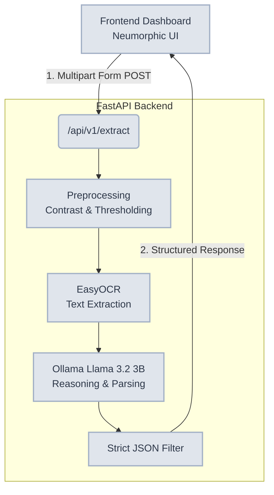
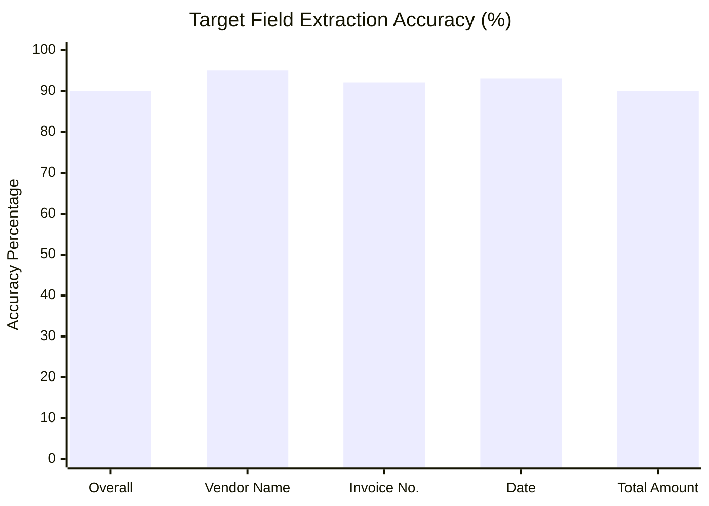

# UI/UX Architecture & Design Specification: Local AI Invoice Extraction Engine


## 1. Design System & Aesthetics: Advanced Neumorphism (Soft UI)

To establish a highly professional, modern, and state-of-the-art aesthetic, the frontend will be built entirely using a strict **Neumorphic** design system. Neumorphism uses a combination of light and shadow on a solid background color to create the illusion of extruded shapes (buttons, cards) and recessed areas (inputs, dropzones), resulting in a unified and highly tactile interface.

### Color Palette & Tokens
- **Canvas / Background:** `#E0E5EC` (Soft, cool gray-blue - crucial for the neumorphic effect)
- **Primary Typography:** `#2D3748` (Slate dark gray for high readability)
- **Secondary Typography:** `#718096` (Muted gray for labels, hints, and secondary metrics)
- **Primary Accent:** `#4299E1` (Professional blue for active buttons, progress indicators)
- **Success State:** `#48BB78` (For API health 'Active' status and >90% extraction confidence)
- **Warning/Error State:** `#F56565` (For offline statuses, errors, or low-confidence extractions)

### Typography
- **Headings & Primary UI Elements:** `Inter` or `Outfit` (Clean, highly legible modern sans-serif)
- **Data Viewing & JSON Responses:** `Fira Code` or `JetBrains Mono` (Monospace for structured data visualization)

### Core CSS Neumorphic Utilities
The entire UI relies on precise shadow calculations for the base color (`#E0E5EC`):

```css
/* Extruded Elements (Cards, Default Buttons) */
.neumorphic-card {
    background: #E0E5EC;
    border-radius: 16px;
    box-shadow: 9px 9px 16px rgb(163,177,198,0.6), 
               -9px -9px 16px rgba(255,255,255, 0.5);
}

/* Inset Elements (Input Fields, Dropzones, Data Displays) */
.neumorphic-inset {
    background: #E0E5EC;
    border-radius: 12px;
    box-shadow: inset 6px 6px 10px 0 rgba(163,177,198, 0.7), 
                inset -6px -6px 10px 0 rgba(255,255,255, 0.8);
}

/* Pressed State (Active Buttons) */
.neumorphic-pressed {
    background: #E0E5EC;
    box-shadow: inset 4px 4px 8px rgb(163,177,198,0.6), 
                inset -4px -4px 8px rgba(255,255,255, 0.5);
}
```

---

## 2. Dashboard Layout & Required Features

The web interface is designed to seamlessly interface with the local FastAPI backend, providing an intuitive surface for interacting with the EasyOCR + Llama 3.2 pipeline.

### A. Persistent Sidebar Navigation
- **API Health Indicator:** A pulsating neon dot (Green/Red) actively polling the backend health status.
- **Mode Toggle:** Extruded segmented control allowing the user to switch between **Single Invoice Processing** and **Batch Evaluation Mode** (designed to handle Voxel51 Batches 2 & 3).
- **System Telemetry Panel:** 
  - Total Invoices Processed (Session-based)
  - Average Processing Time (Target: <5s)
  - Historical Accuracy (Visualized via neumorphic circular progress rings).

### B. Single Extraction View (Main Area)

#### 1. The Ingestion Zone
- **Smart Dropzone:** A large `neumorphic-inset` area for drag-and-drop file upload. Visual states respond to drag-enter events (shadows deepen).
- **Quick-Load Samples:** A row of small `neumorphic-card` buttons that instantly load and submit predefined test samples from the Voxel51 dataset, reducing friction during live hackathon demos.

#### 2. The Extraction Dashboard (Post-Submission)
Once an invoice is submitted to `/api/v1/extract`, the UI transitions to a side-by-side analysis view:

**Left Panel: Document Viewer**
- A high-resolution preview of the uploaded JPG/PNG.
- Contained within a `neumorphic-card` with hover-to-zoom capabilities.

**Right Panel: Structured Data Output**
- **Dynamic Data Fields:** The core extracted values are presented individually in `neumorphic-inset` fields, resembling physical form fields.
  - **Vendor Name**
  - **Invoice Number**
  - **Date** (Normalized to YYYY-MM-DD)
  - **Total Amount** (Cleaned of currency symbols)
- **Pipeline Metrics:** Display of processing time (e.g., "⏱️ 4.2s") emphasizing the speed of the local Llama 3.2 3B model.
- **Raw JSON Inspector:** A collapsible accordion displaying the raw JSON payload returned by the server, styled with syntax highlighting inside an inset container.

---

## 3. Interaction Design & Micro-Animations

To ensure the design feels responsive, premium, and alive, specific micro-interactions are required:

- **Liquid Transitions:** All hover and active states must transition smoothly over `0.3s ease`. When a button is hovered, the shadow intensity decreases; on click, it instantly becomes an inset shadow (pressed).
- **Processing State:** While waiting on the Llama 3.2 inference, instead of a standard spinner, the data fields will display a pulsing, skeleton-loading animation (a subtle shimmering gradient overlay) to build anticipation and indicate processing logic.
- **Success Feedback:** Upon successful JSON extraction, the data fields will subtly flash the success accent color (`#48BB78`) before settling back to the default text color.

---

## 4. Backend Integration & Data Flow

The frontend operates as a decoupled presentation layer communicating exclusively via REST API.



### Key API Touchpoints
- **Upload:** `POST /api/v1/extract` (Content-Type: `multipart/form-data`)
- **Error Handling:** If the Ollama service is unavailable or VRAM is exhausted, the UI will intercept the 500 error and present a graceful, user-friendly notification in the top right corner (using a red `neumorphic-card` toast notification) rather than breaking the application state.
- **Evaluation Integration:** Future scaling to Batch 2 & 3 images will utilize polling to a theoretical `/api/v1/batch` endpoint, updating the System Telemetry Panel in real-time.

---

## 5. Data Visualization & Analytics

To provide comprehensive insights into the extraction engine's performance, the frontend will feature an interactive Analytics Panel specifically tailored for evaluating Voxel51 dataset batches.

### Interactive Charts (Powered by Chart.js or Recharts)

1. **Extraction Accuracy Radar Chart:**
   - Visualizes the confidence and accuracy across the 4 primary fields (Vendor Name, Invoice Number, Date, Total Amount).
   - Designed with a translucent blue fill (`rgba(66, 153, 225, 0.2)`) over a neumorphic inset canvas to maintain the soft UI aesthetic.
   
2. **Processing Time Distribution (Bar Chart):**
   - Displays a histogram of processing times (e.g., 2s, 3s, 4s, 5s+) for the current session or batch.
   - Highlights the 95th percentile to ensure the `<5s` target is maintained.
   - Bars will have a soft, extruded appearance with rounded caps and subtle inner shadows.

3. **Batch Progress & Success Rate (Donut Chart):**
   - Tracks the progress of massive batch processing (e.g., Voxel51 Batches 2 & 3).
   - Displays a large, bold metric showing the overall success rate percentage in the center.
   - The ring uses the primary accent (`#4299E1`) for successful extractions, and the error state (`#F56565`) for failures/OOM errors.

### Target Performance Visualization

Below is a conceptual visualization of the target extraction accuracy that will be rendered dynamically in the dashboard:



These visualizations will be embedded within `neumorphic-inset` containers to ensure the charts feel like they are etched directly into the dashboard surface, maintaining the illusion of depth across the entire application.
